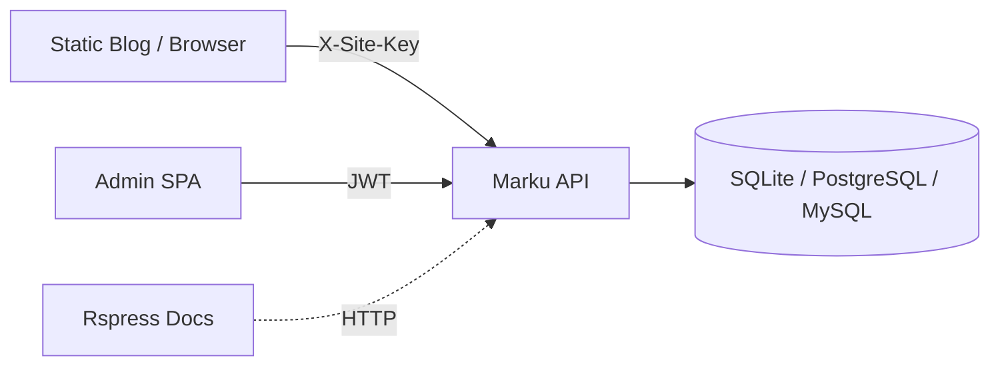

# Marku

Marku 是一个面向静态博客的无头动态内容扩展平台。博客保持原有的构建与部署方式，通过公共 API 或可选官方组件接入评论、浏览量和点赞。

当前完成 **M0 到 M8 的 v0.1 收口**。API 已具备管理员 JWT、站点 CRUD、Site Key 管理、多站点隔离、评论审核与楼中楼、浏览量、点赞、聚合统计、OpenAPI、共享类型、Demo seed 与 Docker 部署。Admin 已具备登录鉴权、全局看板、站点向导、Site Key 管理、数据分析和完整评论审核流程。文档站基于 Rspress，纯 HTML 示例可直接演示完整接入。Next.js 示例不纳入 v0.1。

## 架构

| 路径 | 技术 | 职责 |
| --- | --- | --- |
| `apps/api` | Go + Gin + GORM + SQLite | 多站点动态内容 API |
| `apps/admin` | React + Vite + TypeScript + Tailwind CSS | 站点管理与数据后台 |
| `apps/docs` | Rspress | 文档站 |
| `packages/client` | 可选 | Headless 数据客户端，无 UI |
| `packages/embed` | 可选 | Web Component 评论组件 |
| `packages/shared` | TypeScript | OpenAPI 生成的共享 TypeScript 类型 |
| `examples/html-blog` | 原生 HTML/CSS/JS | 不依赖框架的完整接入示例 |
| `examples/nextjs-blog` | 不纳入 v0.1 | 后续接入参考 |

## 环境要求

- Node.js 24 LTS
- pnpm 12+
- Go 1.27+
- Git

## 快速开始

```bash
pnpm install
pnpm dev
```

默认地址：

- API：`http://localhost:36580`
- Admin：`http://localhost:36581`
- Docs：`http://localhost:36582`
- HTML 示例：`http://localhost:36583`
- 健康检查：`http://localhost:36580/healthz`
- 数据库就绪检查：`http://localhost:36580/readyz`

默认使用 SQLite，数据文件为 `apps/api/data/marku.db`，首次启动自动创建。

### 架构



## 环境变量

按需复制示例文件：

```bash
cp apps/api/.env.example apps/api/.env
cp apps/admin/.env.example apps/admin/.env.local
```

Admin 开发服务器默认代理 `/api/v1` 到 `http://localhost:36580`。
API 不复制环境文件也能使用默认配置启动。真实密钥不要提交到仓库。

管理员登录需要先在 `apps/api/.env` 中设置 `MARKU_JWT_SECRET`、`MARKU_ADMIN_EMAIL` 和 `MARKU_ADMIN_PASSWORD`。首次启动会自动创建管理员，密码只在首次创建时使用。

## 常用命令

```bash
pnpm dev              # 同时启动 API、Admin 和 Docs
pnpm dev:api          # 只启动 API
pnpm dev:admin        # 只启动 Admin
pnpm dev:docs         # 只启动文档站
pnpm dev:html-example # 启动纯 HTML 接入示例
pnpm migrate          # 执行 API 数据库迁移
pnpm seed             # 写入演示站点、评论、浏览量和点赞
pnpm generate:types   # 从 OpenAPI 生成共享 TypeScript 类型
pnpm build            # 构建所有可构建的 workspace 包
pnpm lint             # Go vet（Admin 不引入前端 lint 工具）
pnpm typecheck        # Go vet + TypeScript 类型检查
pnpm test             # Go 测试 + Admin Vitest
pnpm format           # gofmt
```

也可以使用 workspace filter：

```bash
pnpm --filter @marku/api dev
pnpm --filter @marku/admin build
```

## 文档与演示

- API 文档：`http://localhost:36580/docs`
- OpenAPI：`http://localhost:36580/openapi.yaml`
- 共享类型：`packages/shared/src/api.d.ts`
- 纯 HTML 接入示例：`examples/html-blog/README.md`
- Rspress 文档源码：`apps/docs/docs`

## Docker

```bash
cp .env.example .env
# 填写 MARKU_JWT_SECRET、MARKU_ADMIN_PASSWORD、MARKU_IP_HASH_SALT
docker compose up -d --build
```

默认地址：

- API：`http://localhost:36580`
- Admin：`http://localhost:36581`
- API 文档：`http://localhost:36580/docs`

SQLite 数据保存在 Docker volume `marku_marku-data`。备份示例：

```bash
docker run --rm -v marku_marku-data:/data -v "$PWD:/backup" alpine \
  tar czf /backup/marku-data.tar.gz -C /data .
```

使用 PostgreSQL：

```bash
# 在 .env 中设置 MARKU_DB_DRIVER=postgres 和 MARKU_DB_DSN
docker compose --profile postgres up -d --build
```

API 关键路径由 Router、Service、Repository 自动化测试覆盖，并通过 `go test -race ./...` 验证。

## 目录结构

```text
marku/
├── apps/
│   ├── api/          # Go API
│   ├── admin/        # React 管理后台
│   └── docs/         # Rspress 文档站
├── packages/
│   ├── client/       # 可选 Headless SDK
│   ├── embed/        # 可选 Web Component
│   └── shared/       # OpenAPI 生成的共享类型
├── examples/
│   ├── html-blog/    # 纯 HTML/CSS/JS 接入示例
│   └── nextjs-blog/  # Next.js 示例（后续版本）
├── DEVELOPMENT_TASKS.md
├── package.json
└── pnpm-workspace.yaml
```

## 当前进度

- M0 Monorepo 基建
- M1 API 基础设施
- M2 多站点与鉴权
- M3 评论
- M4 浏览量
- M5 点赞
- M6 API 文档与容器化
- M7 Admin 功能
- M8 集成示例、文档与 v0.1 发布收口（Next.js 示例不纳入 v0.1）

详细任务见 `DEVELOPMENT_TASKS.md`。

## 说明

- 站点凭证统一称为 **Site Key**，它会出现在博客前端，不是 Secret。管理端使用 JWT。
- `apps/docs` 使用 Rspress 构建，产物位于 `apps/docs/doc_build`。
- Go module path 暂定为 `marku/api`，确定正式仓库地址后统一替换。
- Admin 前端质量门禁为 TypeScript 严格模式、Vitest 与生产构建，不引入 ESLint、Oxlint 或 Prettier。
