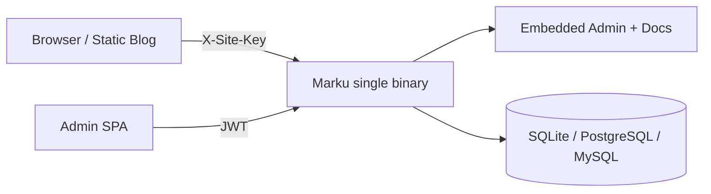

# Marku

Marku 是一个面向静态博客的无头动态内容扩展平台。博客保持原有的构建与部署方式，通过公共 API 或可选官方组件接入评论、浏览量和点赞。

当前版本 **v0.3.1**。API 已具备管理员 JWT、站点 CRUD、Site Key 管理、多站点隔离、评论审核与楼中楼、浏览量、点赞、聚合统计、OpenAPI、共享类型与 Docker 部署。Admin 与 `/embed/v1` 组件通过 `go:embed` 内置于官方二进制；官网与文档站（`apps/web`）独立部署，不再进入镜像。

## 架构

| 路径 | 技术 | 职责 |
| --- | --- | --- |
| `apps/api` | Go + Gin + GORM + SQLite | 多站点动态内容 API |
| `apps/admin` | React + Vite + TypeScript + Tailwind CSS | 站点管理与数据后台 |
| `apps/web` | Rspress | 官网与文档站，独立部署 |
| `packages/client` | TypeScript | Headless 数据客户端，无 UI |
| `packages/embed` | Web Components | 评论、点赞、统计组件，Shadow DOM + CSS 变量 |
| `packages/shared` | TypeScript | OpenAPI 生成的共享 TypeScript 类型 |
| `examples/html-blog` | 原生 HTML/CSS/JS | 不依赖框架的完整接入示例 |
| `examples/nextjs-blog` | 不纳入 v0.1 | 后续接入参考 |

## 环境要求

- Node.js 24 LTS
- pnpm 12+
- Go 1.27+
- Git

## 快速开始

```bash
pnpm install
pnpm dev
```

默认地址：

- API：`http://localhost:36580`
- Admin：`http://localhost:36581`
- 官网 / 文档：`http://localhost:36582/`
- HTML 示例：`http://localhost:36583`
- 健康检查：`http://localhost:36580/healthz`
- 数据库就绪检查：`http://localhost:36580/readyz`

默认使用 SQLite，数据文件为 `apps/api/data/marku.db`，首次启动自动创建。

### 架构



## 环境变量

按需复制示例文件：

```bash
cp apps/api/.env.example apps/api/.env
cp apps/admin/.env.example apps/admin/.env.local
```

Admin 开发服务器默认代理 `/api/v1` 到 `http://localhost:36580`。
API 不复制环境文件也能使用默认配置启动。真实密钥不要提交到仓库。

管理员登录需要先在 `apps/api/.env` 中设置 `MARKU_JWT_SECRET`、`MARKU_ADMIN_EMAIL` 和 `MARKU_ADMIN_PASSWORD`。首次启动会自动创建管理员，密码只在首次创建时使用。

## 常用命令

```bash
pnpm dev              # 同时启动 API、Admin 和 Docs
pnpm dev:api          # 只启动 API
pnpm dev:admin        # 只启动 Admin
pnpm dev:docs         # 只启动文档站
pnpm dev:html-example # 启动纯 HTML 接入示例
pnpm migrate          # 执行 API 数据库迁移
pnpm seed             # 写入演示站点、评论、浏览量和点赞
pnpm generate:types   # 从 OpenAPI 生成共享 TypeScript 类型
pnpm build            # 构建所有可构建的 workspace 包
pnpm build:binary     # 构建内置 Admin 与组件的单二进制 dist/marku-api
pnpm lint             # Go vet（Admin 不引入前端 lint 工具）
pnpm typecheck        # Go vet + TypeScript 类型检查
pnpm test             # Go 测试 + Admin Vitest
pnpm format           # gofmt
```

也可以使用 workspace filter：

```bash
pnpm --filter @marku/api dev
pnpm --filter @marku/admin build
```

## 文档与演示

- Admin：`http://localhost:36580/`
- 官网与文档（独立服务）：`http://localhost:36582/`
- Swagger UI：`http://localhost:36580/swagger`
- OpenAPI：`http://localhost:36580/openapi.yaml`
- 共享类型：`packages/shared/src/api.d.ts`
- 纯 HTML 接入示例：`examples/html-blog/README.md`
- 官网与文档源码：`apps/web/docs`

## 客户端与组件

`@marku/client` 是无 UI 的类型化客户端：

```ts
import { MarkuClient } from '@marku/client'

const marku = new MarkuClient({
  baseUrl: 'https://api.example.com/api/v1',
  siteKey: 'mk_your_site_key',
})

const post = marku.forPath('/posts/hello')
const stats = await post.stats()
await post.comments.create({ authorName: 'Ada', content: '你好。' })
```

`@marku/embed` 提供可直接落地的 Web Component，构建产物会随单二进制分发到
`/embed/v1/marku-embed.js`：

```html
<script type="module" src="https://api.example.com/embed/v1/marku-embed.js"></script>

<marku-stats record-view></marku-stats>
<marku-like></marku-like>
<marku-comments api="https://api.example.com/api/v1" site-key="mk_your_site_key"></marku-comments>
```

主题通过 `--marku-*` 变量与 `::part()` 定制，详见
`apps/web/docs/guide/embed.md`；需要完全自定义 UI 时使用
`packages/client/README.md`。

## npm 发布

`@marku/client` 与 `@marku/embed` 已配置 `publishConfig`（public）、
`exports`、类型声明和 `prepublishOnly` 构建。

```bash
# 1. 确认版本号（两个包独立 semver）
pnpm --filter @marku/client build
pnpm --filter @marku/embed build

# 2. 登录并发布
pnpm publish:client
pnpm publish:embed
```

发布前请确认：

- npm scope `@marku` 可用，或先改为自己的 scope。
- 账号已登录（`npm login`），CI 发布需配置 `NPM_TOKEN`。
- 需要 provenance 时在 CI 中使用 `npm publish --provenance --access public`。
- `dist/` 已重新生成，且 `pnpm typecheck && pnpm test` 通过。
- 版本号与 `CHANGELOG.md` 已更新。

## Docker

```bash
cp .env.example .env
# 填写 MARKU_JWT_SECRET、MARKU_ADMIN_PASSWORD、MARKU_IP_HASH_SALT
docker compose up -d --build
```

也可以直接使用 GHCR 多架构镜像（`v*` tag 自动发布）：

```bash
docker pull ghcr.io/zwying0814/marku:0.3.1
docker run -d --name marku --restart unless-stopped \
  --env-file .env -p 127.0.0.1:36580:36580 \
  -v marku-data:/data ghcr.io/zwying0814/marku:0.3.1
```

默认地址：

- API / Admin：`http://localhost:36580`
- 官网与文档：独立构建 `apps/web` 后部署，不在镜像内
- Swagger UI：`http://localhost:36580/swagger`

SQLite 数据保存在 Docker volume `marku_marku-data`。备份示例：

```bash
docker run --rm -v marku_marku-data:/data -v "$PWD:/backup" alpine \
  tar czf /backup/marku-data.tar.gz -C /data .
```

使用 PostgreSQL：

```bash
# 在 .env 中设置 MARKU_DB_DRIVER=postgres 和 MARKU_DB_DSN
docker compose --profile postgres up -d --build
```

API 关键路径由 Router、Service、Repository 自动化测试覆盖，并通过 `go test -race ./...` 验证。

## 目录结构

```text
marku/
├── apps/
│   ├── api/          # Go API
│   ├── admin/        # React 管理后台
│   └── docs/         # Rspress 文档站
├── packages/
│   ├── client/       # Headless SDK（@marku/client）
│   ├── embed/        # Web Components（@marku/embed）
│   └── shared/       # OpenAPI 生成的共享类型
├── examples/
│   ├── html-blog/    # 纯 HTML/CSS/JS 接入示例
│   └── nextjs-blog/  # Next.js 示例（后续版本）
├── DEVELOPMENT_TASKS.md
├── package.json
└── pnpm-workspace.yaml
```

## 当前进度

- M0 Monorepo 基建
- M1 API 基础设施
- M2 多站点与鉴权
- M3 评论
- M4 浏览量
- M5 点赞
- M6 API 文档与容器化
- M7 Admin 功能
- M8 集成示例、文档与 v0.1 发布收口（Next.js 示例不纳入 v0.1）
- v0.2.0 单二进制发行（Admin 与 Docs 内置；v0.3 起官网独立部署）
- M9 集成包：`@marku/client`、`@marku/embed` 与 `/embed/v1` 分发（npm 发布待定）
- v0.3.0：客户端与组件包发布、官网拆分
- v0.3.1：修复镜像内缺少 `/embed/v1`，新增 GHCR 多架构镜像发布

详细任务见 `DEVELOPMENT_TASKS.md`。

## 说明

- 站点凭证统一称为 **Site Key**，它会出现在博客前端，不是 Secret。管理端使用 JWT。
- 开发模式使用独立 Vite/Rspress 服务；`pnpm build:binary` 只把 Admin 与
  `@marku/embed` 产物嵌入 Go 二进制。
- `apps/web` 使用 Rspress 构建，产物位于 `apps/web/doc_build`，独立部署。
- Go module path 暂定为 `marku/api`，确定正式仓库地址后统一替换。
- Admin 前端质量门禁为 TypeScript 严格模式、Vitest 与生产构建，不引入 ESLint、Oxlint 或 Prettier。
